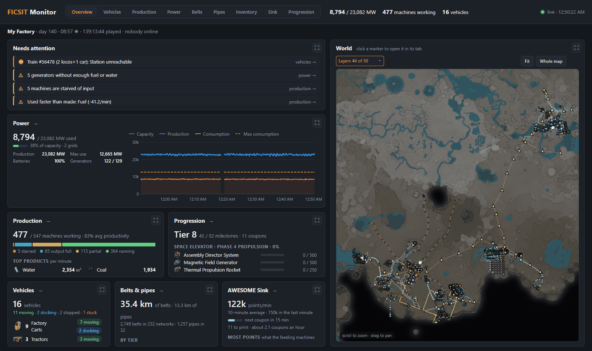
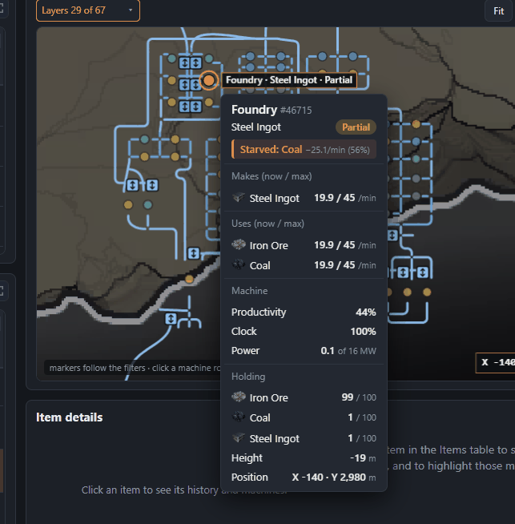
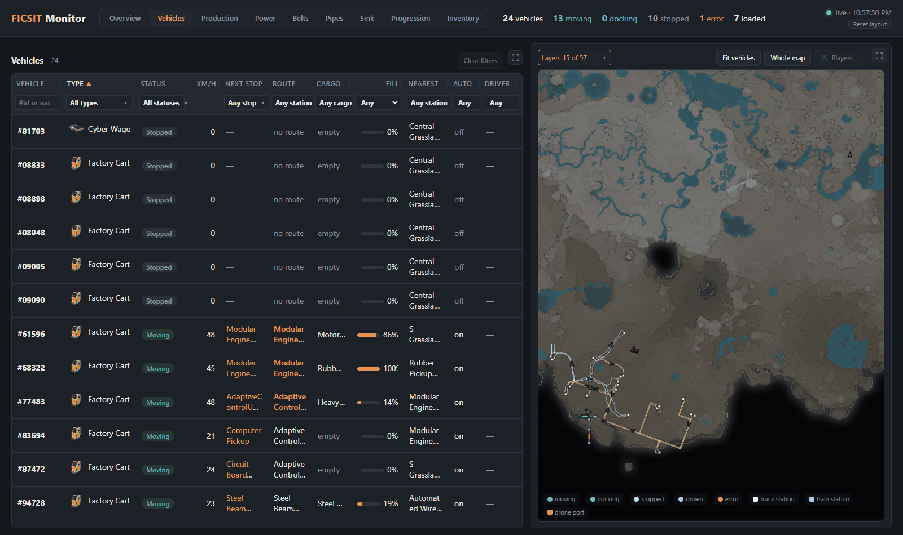
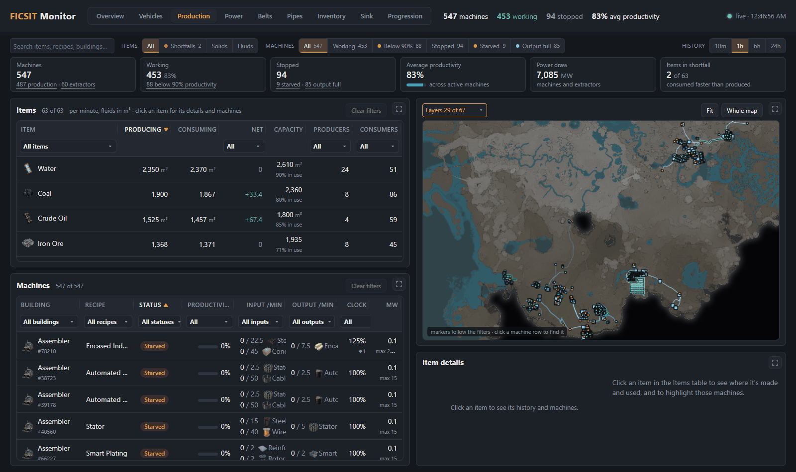
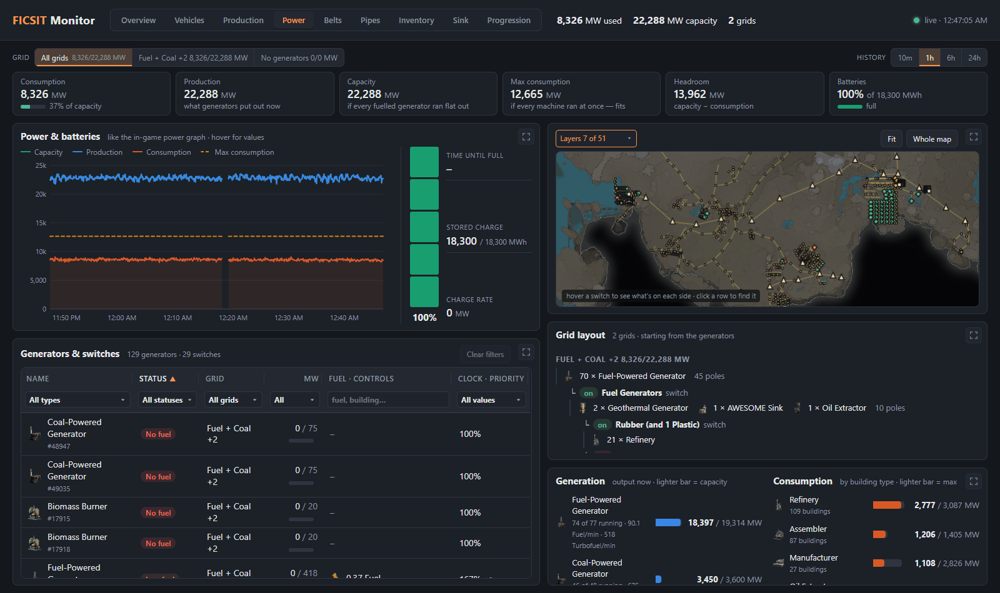
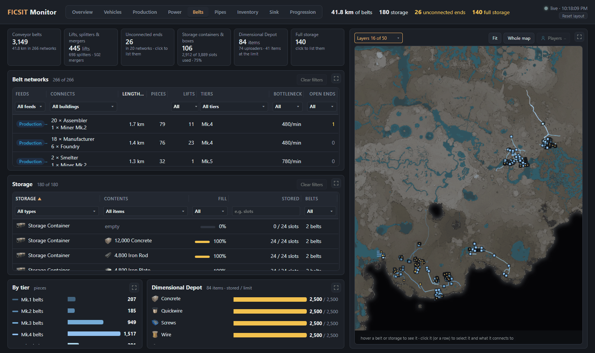
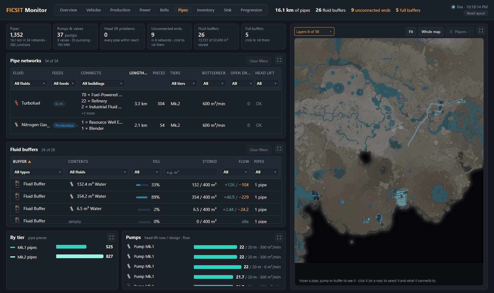
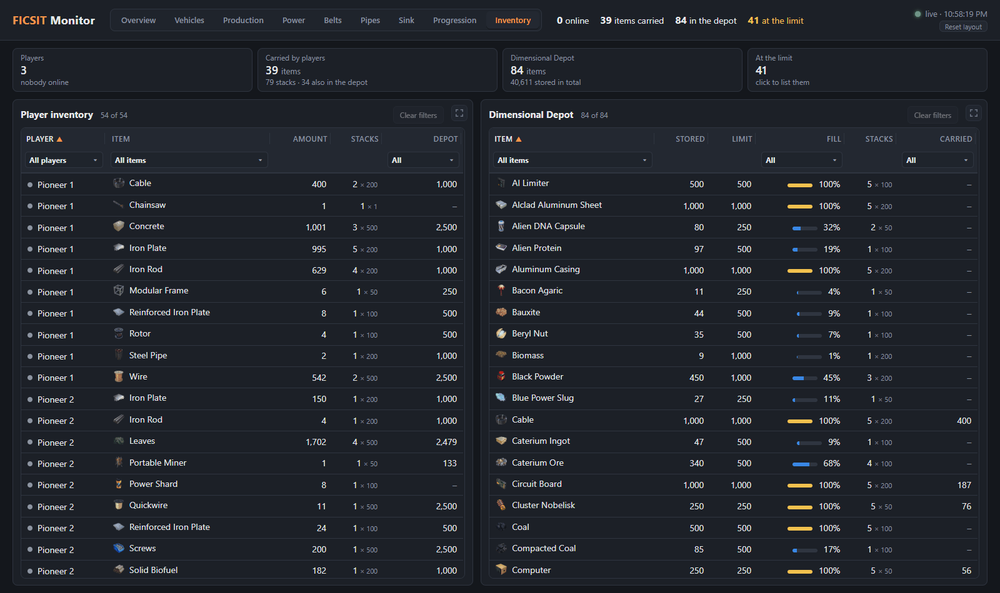
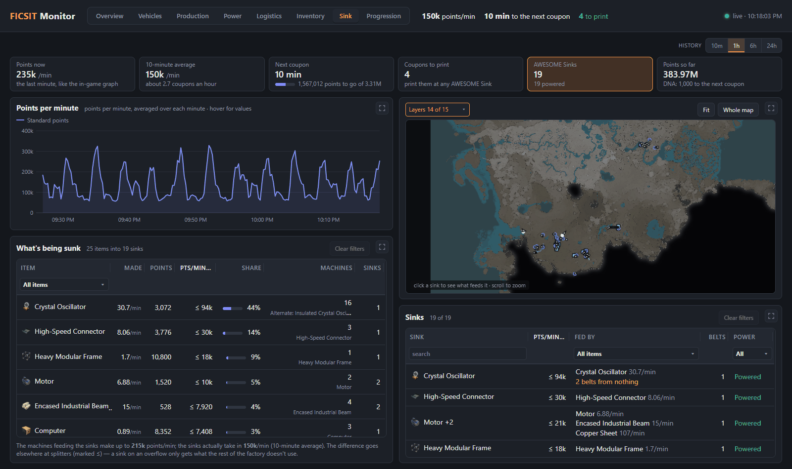
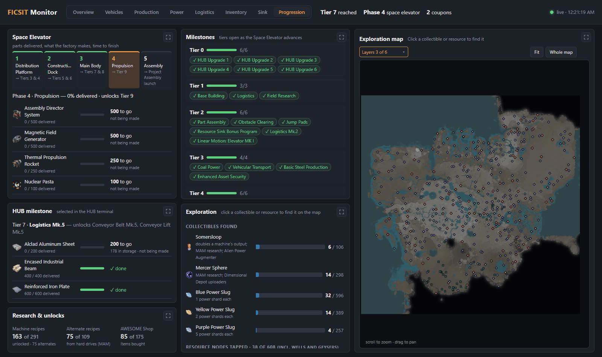

# Ficsit Remote Monitoring – FICSIT Monitor

A live web dashboard for a Satisfactory world: how the factory is doing at a glance, every vehicle, every production machine, the power grid, every conveyor belt and pipe, what players and the Dimensional Depot hold, FICSIT Coupon income, and your progression. It reads data from the [Ficsit Remote Monitoring](https://github.com/porisius/FicsitRemoteMonitoring) (FRM) mod's web API.



## Maps

On a desktop every tab's map sits in the same place on the right, at the same size, and changing tabs keeps the same spot and zoom, so the map doesn't move or flash when you switch. The **Players** button beside Whole map centres on a player; click again for the next one (online players first, then A–Z; right-click goes back).

Every tab's map shares the same parts: a Layers dropdown with **everything** — factory buildings, vehicles and their paths, stations, the power network, belts, pipes, storage, resource nodes, collectibles, hypertubes (tubes, entrances and the open ends rides launch from, with their angle) and players. Each tab starts with only what it's about switched on, plus players (the Overview starts with everything except resource nodes and collectibles); switch anything else on from the menu, and the page only fetches what's switched on. Right-click a map to open the same spot in another tab's map, and hover anything for a detailed popup. Machines, generators, vehicles, stations, storage, belts and pipes, power poles and switches, players, resource nodes and collectibles all show a title, a status badge and labelled rows: what it's doing, rates, contents, its power grid, height and position. Extractors also show what they took out over the last 10 minutes and hour, the most they can at their clock speed, what's unused, and the node's purity. Anything with a problem says why in one line under its title, with numbers: a machine that's "Starved: Coal −25/min (56%)" or has its "Output full", a generator with no fuel (and how much it burns), a train that can't reach its next station (on a different track, or check signals), a fuse that tripped (what the grid wants vs makes), full storage, a pump past its head lift, batteries draining.



## Tabs

### Overview (home)
- **Needs attention**: an overloaded grid or tripped fuse, max consumption over capacity, generators out of fuel or water, starved machines, items used faster than they're made, stuck vehicles (derailed, station unreachable, …), unconnected belt/pipe ends, AWESOME Sinks without power, milestones ready to unlock, coupons to spend. Each links to the tab that explains it.
- **Summary cards** in rows: power (key figures and the four-line power chart); production (status mix, top products, shortfalls) and progression (Space Elevator and HUB parts); vehicles (per type, stuck ones by name), belts & pipes (totals by tier, head lift problems) and the AWESOME Sink (points per minute, time to the next coupon, the items earning the most).
- **World map** of machines, generators, vehicles, players, the HUB, the Space Elevator, AWESOME Sinks, every belt and pipe, the power network (lines, poles, wall outlets, towers, switches, power storage), every storage container, fluid buffer and Dimensional Depot uploader, hypertubes, roads, rail, drone routes and truck / train stations, with a categorized Layers dropdown.

### Vehicles

- **Table of every vehicle**: factory carts, tractors, trucks, fluid trucks, explorers, Cyber Wagons, trains and drones, with status (moving, docking, stopped, driven, error), speed, next stop, route, cargo, fill level, nearest station, autopilot and driver. A filter under every column; station and cargo filters are searchable multi-selects.
- **Live map** with smoothly moving markers (it only redraws while something moves). Hover a vehicle to highlight its stops; hover a station to see what's in it; click a row to follow a vehicle.

### Production

- **Items**: producing, consuming and net per minute for every item (generators' fuel and water included), capacity and how much of it is in use. Click an item to see its history and highlight the machines that make (blue) and use (orange) it, in the table and on the map.
- **Machines**: status (running, partial, starved, output full, paused, no power), productivity, input and output, clock speed, power shards, Somersloops and power draw. A filter under the columns (building, recipe, status, productivity, inputs, outputs, clock); click a row to find the machine on the map.
- **Item details** under the two tables: the picked item's history, the machines that make and use it, and its recipes (a one-line strip until you pick an item).
- The summary tiles are shortcuts: click "5 starved" to see those five.

### Power

- **All grids** together or one grid at a time. Grids are named after what powers them, biggest share first, with used / max: "Nuclear 200/2,000 MW", "Coal 1", "Coal 2"; grids with no generators come last.
- The in-game power graph's numbers (capacity, production, consumption, max consumption) plus headroom, batteries and fuse state.
- **Power & batteries**: the power graph with a stored-charge graph (MWh) under it on the same time axis, beside a battery readout like the in-game Power Storage panel: charge gauge and %, time until full (or empty while draining), stored charge (e.g. 3,300 / 3,300 MWh) and charge rate.
- **Generators & switches** in one table, with a filter under every column: each generator's output, fuel and water; each power switch's state, priority group (Undefined turns off first, then 8 … 1), what it's fed from and what it controls. Hover a switch to see its two sides on the map (supply blue, controlled orange).
- **Grid layout**: each grid's sections, following the switches out from the generators.
- Generation by generator type and consumption by building type, beside the grid layout.
- A map of the power network: lines, poles, wall outlets, towers, switches and power storage, with the selected grid bright and the rest faded.

### Belts

- Every conveyor belt grouped into **networks** (belts that connect to each other; conveyor lifts are belt pieces that go up or down, so a line keeps going through them), and every item **storage** building: Storage Container, Industrial Storage Container, Personal / Medical / Hazard Storage Box (and the HUB's), Dimensional Depot Uploader and dismantle / death crate.
- Totals: belts, lifts, splitters and mergers, unconnected ends, slots used across containers, depot items at their limit, and full storage (click those to list them).
- **Belt networks table**: what each network feeds (production, power), the buildings it connects (storage included), its length, pieces, lifts, tier mix and bottleneck (the slowest tier, lifts included), and open ends. **Storage table**: type, contents, slots used, amount stored and the belts into it.
- The two are **linked**: click a network (in the table or on the map) and the storage it reaches is pinned to the top of the Storage table and ringed on the map; click a storage and the belts into it are pinned and drawn on the map. Every column of both tables has a filter, and the map follows them.
- Under the tables: belt and lift pieces by tier, and every **Dimensional Depot** item against its limit (an uploader counts as full only when the depot can't take any more of its item).
- Lifts are drawn as small squares in their belt tier's colour with a ↕, on top of the belts.

### Pipes

- Every pipe grouped into networks, and every **fluid buffer** (Fluid Buffer, Industrial Fluid Buffer), linked the same way as on the Belts tab.
- Totals: pipes and junctions, pumps and valves (how many are pumping, their power), head lift problems, unconnected ends, m³ stored across buffers, and full buffers.
- **Pipe networks table**: the fluid in each, what it feeds, what it connects, length, pieces, tiers, bottleneck, open ends and head lift. **Fluid buffers table**: contents, how full, fill / drain rate and the pipes into it.
- Under the tables: pipe pieces by tier, and every **pump** with its head-lift gauge (how high it's pushing now, against its design) and flow — click one to find it on the map.
- **Head lift**: liquids only climb so high above whatever pushes them — a pump (Mk.1 20 m, Mk.2 50 m), an extractor or machine output (10 m) or a fluid buffer (8 / 12 m); a little past that the flow drops, a few metres more and it stops. Head lift only passes through completely filled pipes, and a fluid buffer counts as one: a pump's push carries through a buffer once it's full; while it fills, past it only the buffer's own head lift counts, in proportion to how full it is. `server.py` splits the pipes at pumps and filling buffers into runs, finds what pushes each run and how high that reaches, and flags pipe pieces above it: a little over = **near limit** (yellow), past the point where flow stops = **too high** (red). The live contents of those pipes then say how sure that is (they stay empty while the rest of the run has fluid = almost certainly head lift; full anyway = not flagged). Flagged pipes are drawn dashed red / yellow with a ⚠ at the highest point (popup: what pushes it, from what height, how far over); the tile and the Head lift column list them, and the Overview shows them under what needs attention. Gases need no head lift and are skipped.
- Hover a belt, pipe, lift, pump or storage on any map to see it; the maps have one layer per kind of storage building.
- `server.py` works the networks out by following what each belt, lift and pipe end is plugged into (FRM's `ConnectedTo0` / `ConnectedTo1`), through splitters/mergers, junctions/pumps/valves and floor holes. With an FRM build that doesn't report those, it falls back to geometry (ends that meet, each lift joined to the nearest belt end at its height). A network counts as production or power if it reaches a machine or a generator. It doesn't know what's on a belt or how full it is.

### Inventory

- **Player inventory**: what every player is carrying, one row per player and item, with the amount, the stacks it takes, and how many of that item the Dimensional Depot holds. Players who are online come first.
- **Dimensional Depot**: every item in the depot with its amount, limit, how full it is, stacks, and how many players are carrying right now. Click "At the limit" to list the items that can't take any more uploads.
- The two are **linked**: click an item in either table and it is marked in both, pinned to the top of the other one. Every column has a filter under it.

### Sink

- FICSIT Coupon income: points per minute in the last minute and over 10 minutes (the in-game sink graph's numbers), time until the next coupon and how far along it is, coupons waiting to be printed, total points and DNA points.
- **Points per minute** over 10 minutes to 24 hours, from `server.py`'s own record of the sink's running total.
- **What's being sunk**: every item reaching an AWESOME Sink, how fast it's made, its points, points per minute and share, and the machines and recipes making it.
- **Sinks**: each sink named after what feeds it most, the items it gets, belts into it, storage or stations it's fed from, belts that start at nothing, and power. Click one (in the table or on the map) to see only its items and ring the machines feeding it.
- `server.py` follows the belts back from each sink (through splitters, mergers, lifts and floor holes) to the machines, storage and stations they start at; this needs FRM's `ConnectedTo0` / `ConnectedTo1` fields. Belts don't report their flow, so an item's points per minute is what its machines make: where a splitter on the way sends some of it elsewhere it's marked ≤, and the tab shows it beside what the sinks actually take in.

### Progression

- Space Elevator phase with each part's delivered amount, how many are in storage, how fast the factory makes them and time to finish; the HUB's active milestone; milestones per tier (hover one to see what it unlocks: buildings, recipes and the machine that makes each, equipment, and what it still costs); MAM research; alternate recipes, AWESOME Shop and coupons.
- Collectibles found (Somersloops, Mercer Spheres, power slugs) and resource nodes tapped. Click one to find the ones still out there on the map.

### Everywhere
- Every map has a **Layers** dropdown, X/Y coordinates under the cursor, and shows players (online and offline) as arrows pointing the way they face. **Right-click** a map to open the same spot, at the same zoom, in another tab's map. The Production map shows the belts and pipes of production lines; the Overview map shows them all, the Belts and Pipes maps one each.
- Every table has its title and row count on the left, **Clear filters** on the right, and filters under the column headings.
- Every panel has a **full-screen** button (Esc to close). Table columns can be resized (double-click an edge to fit) and sorted.
- On a desktop browser each tab fits one screen, with the map on the right; on phones the panels stack and the map comes last.
- **Resize anything** (desktop): drag the gap between two panels to give one more room, and drag the map's left edge to make it wider (one width for every tab). Pull a gap further and the panels after it squeeze down to their titles one by one; pull back and they open again in reverse. The top tiles resize sideways. Double-click a gap to put that group back, or use **Reset layout** under the clock in the header for everything. Sizes are remembered in your browser.
- `server.py` records power (battery charge and capacity included), production and sink points history (every 5 s / 15 s, 24 hours kept, saved to `history.json`), so charts have data from before the page was opened. It works out the belt and pipe networks every minute while a page shows them (every 5 minutes for a page in the background, not at all when nobody is looking).

## Requirements
- Satisfactory 1.2 with the **Ficsit Remote Monitoring** mod, with its web server started (`/frm http start` in game chat, or its autostart setting turned on).
- Python 3.9+ (standard library only; [Pillow](https://pypi.org/project/pillow/) is optional, for resizing pictures).
- **FRM 1.5.4 or newer** for everything this dashboard shows. Older builds still work, with less: vehicles have no routes or next stops and stay frozen whenever no player is nearby; power poles, wall outlets and towers are missing from the maps (power lines and switches still show); fluid buffers are missing, storage slots used are estimated from stack sizes and the Dimensional Depot shows amounts without limits; belt / lift / pipe networks are worked out from positions (some lines through conveyor lifts come out split), and the Sink tab can't tell what feeds each sink.
- **Head lift** and the Pipes tab's pumps need FRM [PR #320](https://github.com/porisius/FicsitRemoteMonitoring/pull/320) (pipe contents and flow, each pump's head lift, and which pipe ends are a building's fluid output — not released yet). Without it the Head lift tile says so and pumps aren't shown.
- **FRM 1.5.5** (the next release) adds which machine recipes are unlocked, each generator's water level and where a player is looking. Until then the Production tab shows recipes without locked / unlocked, the water level is estimated from the water in the generator, and the maps show players' direction but not whether they're looking up or down.

## Setup
```sh
# one time: map image (from your FRM install), vehicle pictures and item/building icons (from the Satisfactory wiki)
python tools/fetch_assets.py --game-dir "<path to Satisfactory or SatisfactoryDedicatedServer>"

# run it
python server.py
```
Then open http://localhost:8090.

Options:
- `--frm http://<host>:8080`, or set `FRM_URL`, if FRM runs on another machine.
- `--host 0.0.0.0` to open the dashboard from other devices on your network.
- `--port` to use a port other than 8090.
- `--no-history` to not record power, production and sink history.

`items.json` (every item in the game, with fuel energy values) is included. To regenerate it after a game update, run `python tools/generate_items.py --game-dir "<Satisfactory install>"`.

## Notes
- The map image, vehicle pictures and icons aren't included because they're Coffee Stain's game art. `fetch_assets.py` gets them on your own machine.
- `server.py` serves the page and passes API calls through to FRM, so the browser never has to deal with cross-origin (CORS) restrictions.
- **Load on the game server**: FRM answers most calls on the game thread, so the dashboard tries to ask little:
  - each tab polls only what it shows, and maps fetch shared data (players, power network, storage, belts and pipes) only while a tab showing them is open;
  - a page in the background (another browser tab, a minimised window) polls at most once a minute and catches up when it's shown again;
  - `server.py` caches replies (1 s; 4 s for the big ones), so several open pages and the history recorder share requests, and the Overview reuses the recorder's machine snapshot.
  With one page open this costs FRM about 2–3 s of work a minute; the biggest single request (`getBelts`, a few hundred ms on a large factory) runs once a minute only while belts and pipes are on screen.
- Code: `index.html` (page, Vehicles tab), `js/poll.js` (polling), `js/charts.js` (charts, tables, dropdowns), `js/map.js` (the shared map), `js/resize.js` (resizable panels), and one file per other tab.
